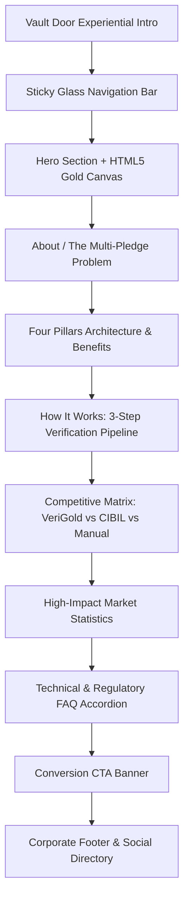

# VeriGold Landing Page — Comprehensive Design Document

**Document Version:** 1.0.0  
**Project:** VeriGold — Cross-Lender Gold Loan Registry  
**Scope:** Landing Page (`landing/index.html`)  
**Target Audience:** Enterprise Fintech Stakeholders, Product Designers, Frontend Engineers, Security Auditors  

---

## 1. Executive Summary & Brand Positioning

VeriGold is India's first privacy-preserving, cross-lender gold loan registry. The platform enables banks, Non-Banking Financial Companies (NBFCs), and institutional gold lenders to verify cross-lender borrower exposure and detect collateral re-pledging without disclosing proprietary customer or loan data.

### 1.1 Brand Identity Pillars
- **Institutional Trust:** Conveying the security, auditability, and regulatory rigor of top-tier financial infrastructure (e.g., RBI compliance, Hyperledger Fabric, Zero-Knowledge Proofs).
- **Physical Collateral Resonance:** Incorporating warm, authentic 24K gold metallic accents balanced against clean, modern cream and dark espresso surfaces, avoiding artificial or saturated tones.
- **Cryptographic Assurance:** Emphasizing mathematical privacy guarantees (HMAC-SHA256, Zero-Knowledge Proofs, deterministic scoring) rather than vague marketing promises.

---

## 2. Design System & Visual Foundations

The visual language follows an **Editorial Fintech Luxury** aesthetic—combining authoritative serif headlines with clear, high-density sans-serif data presentation.

### 2.1 Color Palette & Token Architecture

The color system uses CSS custom properties defined on `:root`:

```css
:root {
  /* Core Brand Colors */
  --gold-dark: #2D1A02;        /* Primary high-contrast text and dark accents */
  --gold-mid: #60420E;         /* Secondary typography and intermediate borders */
  --gold-primary: #C6891C;     /* Traditional gold accent and indicators */
  --gold-light: #E7B55A;       /* Subtle golden borders and highlights */
  --gold-pale: #F5D89A;        /* Light gold decorative tints */

  /* Surface & Canvas Colors */
  --cream: #FFF3E8;            /* Primary warm canvas background */
  --cream-dark: #F0EAE1;       /* Secondary neutral surface */
  --surface-glass: hsla(0, 0%, 100%, 0.65);       /* Frosted glass cards */
  --surface-glass-border: hsla(0, 0%, 100%, 0.2); /* Glass perimeter highlight */

  /* Text & Hierarchy */
  --text-primary: #2D1A02;                      /* High-emphasis text (100% contrast) */
  --text-secondary: rgba(45, 26, 2, 0.7);       /* Medium-emphasis body & subtitles */
  --text-tertiary: rgba(45, 26, 2, 0.5);        /* Low-emphasis metadata & labels */

  /* Gradients */
  --gradient-text: linear-gradient(87deg, #2D1A02 43.61%, #C6891C 64.44%);
  --gradient-text-hero: linear-gradient(87deg, #2D1A02 43.61%, #C6891C 97.44%);
  --gradient-gold-border: linear-gradient(135deg, #E5A93C 0%, #F5C768 50%, #B87B14 100%);

  /* Radiant 24K Gold CTA Button Palette */
  --btn-gold-start: #F5C768;
  --btn-gold-mid: #E5A93C;
  --btn-gold-end: #B87B14;
  --btn-gold-text: #1A0E01;
  --btn-gold-hover-start: #FDE08F;
  --btn-gold-hover-mid: #EDB84F;
  --btn-gold-hover-end: #C78A1D;
  --btn-gold-glow: rgba(229, 169, 60, 0.38);
  --btn-gold-glow-hover: rgba(229, 169, 60, 0.58);
  --gradient-button: linear-gradient(135deg, var(--btn-gold-start) 0%, var(--btn-gold-mid) 48%, var(--btn-gold-end) 100%);
  --gradient-button-hover: linear-gradient(135deg, var(--btn-gold-hover-start) 0%, var(--btn-gold-hover-mid) 48%, var(--btn-gold-hover-end) 100%);
}
```

#### Color Application Matrix

| Token / Color | Hex / Value | Usage | Rationale |
|---|---|---|---|
| **Canvas** | `#FFF3E8` | Full page background | Warm, premium paper/parchment quality; less stark than pure white `#FFFFFF` |
| **Deep Espresso** | `#2D1A02` / `#1A0E01` | Headings, primary text, CTA labels | High contrast (14.2:1 ratio against cream), warmer and more cohesive than pure `#000000` |
| **Radiant Gold Gradient** | `#F5C768` → `#E5A93C` → `#B87B14` | Primary CTA buttons, VG logo mark | Mimics 24K reflective bullion lustre; provides strong visual affordance |
| **Frosted Glass** | `hsla(0, 0%, 100%, 0.65)` | Cards, tables, modals | Modern depth; lets ambient golden particle field softly filter through |
| **Semantic Success** | `#2E8B57` | Verification checks (`✓`) | Institutional green indicating verified status |
| **Semantic Alert** | `#CC4444` | Bureau shortcomings (`✗`) | Subdued crimson avoiding excessive visual panic |
| **Semantic Partial** | `#C6891C` | Partial visibility (`~`) | Warm gold indicating partial or delayed capability |

---

### 2.2 Typography System

The typography pairs an editorial high-contrast serif with a neutral, highly legible sans-serif:

```
Headings & Display Typography: Playfair Display (Serif)
Weights: 600 (SemiBold), 700 (Bold), 800 (ExtraBold)
Feel: Heritage banking, bullion authenticity, legal prestige

Body, Data & Interactive UI: DM Sans (Geometric / Humanist Sans)
Weights: 400 (Regular), 500 (Medium), 600 (SemiBold), 700 (Bold)
Feel: Crisp legibility, optical clarity across small screen sizes
```

#### Type Scale Hierarchy

| Element | Font Family | Size | Weight | Line Height | Letter Spacing |
|---|---|---|---|---|---|
| **Hero H1** | `Playfair Display` | `clamp(2.75rem, 5.5vw, 4.75rem)` | 700 | 1.08 | `-0.01em` |
| **Section Titles (H2)** | `Playfair Display` | `clamp(2rem, 4vw, 3.25rem)` | 700 | 1.15 | `-0.01em` |
| **Card & Feature Titles (H3)**| `Playfair Display` | `1.125rem – 1.25rem` | 700 | 1.25 | `-0.01em` |
| **Stats Metric Display** | `Playfair Display` | `2.75rem` | 700 | 1.00 | `-0.02em` |
| **Section Subtitle** | `DM Sans` | `1.0625rem – 1.125rem` | 400 | 1.65 | `0` |
| **Body Copy** | `DM Sans` | `0.9375rem – 1.0625rem` | 400 / 600 | 1.60 – 1.70 | `0` |
| **Button Label (Primary)** | `DM Sans` | `0.9375rem` | 700 | 1.00 | `+0.01em` |
| **Badges / Section Labels** | `DM Sans` | `0.8125rem` | 700 | 1.00 | `+0.10em` (Caps) |
| **Navigation Links** | `DM Sans` | `0.9375rem` | 500 | 1.00 | `0` |

---

### 2.3 Spatial System & Elevation

- **Base Spacing Grid:** 8px baseline (`0.5rem`, `1rem`, `1.5rem`, `2rem`, `3rem`, `5rem`, `8rem`).
- **Container Max-Width:** `80rem` (1280px) with fluid guttering (`2rem` desktop, `1.25rem` mobile).
- **Corner Radii:**
  - Standard Cards: `--radius-lg` (`2rem` / 32px)
  - Accordion Items: `--radius-md` (`1.5rem` / 24px)
  - Comparison Wrap: `--radius-xl` (`3.75rem` / 60px)
  - Buttons & Badges: Pill (`100px`)
- **Elevation Layers:**
  - Ambient Glass: `backdrop-filter: blur(1.5rem – 2.5rem)`
  - Card Shadow: `0 20px 60px rgba(198, 137, 28, 0.1)`
  - CTA Button Glow: `0 8px 24px rgba(229, 169, 60, 0.38), inset 0 1px 1.5px rgba(255, 255, 255, 0.75)`

---

## 3. Structural Breakdown & Section Architecture



---

### 3.1 Vault Door Intro Animation (`#vaultIntro`)

A physical metaphor of an impenetrable gold bullion vault, setting an immediate impression of security.

- **Visual Assets:** Two solid split doors with horizontal and vertical security grid lines in subtle gold stroke (`rgba(198, 137, 28, 0.03)`).
- **Central Mechanical Wheel (`#vaultHandle`):** 7rem circular brass hub with crossbar and pulsating amber radial glow.
- **Particle Explosion (`#vaultGlow`):** 60 radial golden particles calculated via polar coordinates (`Math.cos`, `Math.sin`).
- **Execution Timeline:**
  1. `T = 800ms`: Wheel rotates 180 degrees (`.spin`).
  2. `T = 1600ms`: Particles emit outward; split vault doors slide left and right (`transform: translateX(±105%)`).
  3. `T = 2800ms`: Canvas unlocks, scroll lock is removed, and hero elements stagger in (`fadeInUp`).
  4. `T = 4500ms`: Overlay DOM node is unmounted (`display: none`) to eliminate memory and paint overhead.

---

### 3.2 Header Navigation (`<header class="header">`)

- **Anatomy:**
  - **Brand Mark:** SVG-styled emblem badge (`VG`) with 24K gold gradient and espresso text, followed by the "VeriGold" wordmark with gradient fill.
  - **Desktop Navigation:** Quick anchors (`#about`, `#benefits`, `#how-it-works`, `#faq`) with interactive hover underlines that scale from center (`width: 100%`).
  - **Action Button:** Radiant gold button (`Get Started`) with diagonal arrow indicator.
  - **Mobile Menu Toggle:** Minimalist three-bar hamburger icon (`display: none` on desktop, active `<= 1024px`).
- **Scroll Behavior:** Transitions dynamically from transparent to frosted glass (`background: rgba(255, 243, 232, 0.85); backdrop-filter: blur(1.5rem); border-bottom: 1px solid rgba(45, 26, 2, 0.08)`) once scroll offset exceeds `60px`.

---

### 3.3 Hero Section (`<section class="hero">`)

The primary above-the-fold engagement zone.

- **Background Animation (HTML5 Canvas):**
  - Lightweight self-contained canvas rendering 80 floating golden embers.
  - Subdued radial gradient backlight focused at `(width * 0.7, height * 0.4)`.
  - Linear horizontal fade mask on the left side ensures text content always maintains WCAG AAA contrast ratio.
- **Content Flow:**
  - **Pill Badge:** Pulsing indicator dot with "Privacy-First Gold Loan Registry".
  - **Hero Title:** Two-line stacked typography ("Verify Before / You Lend.") with secondary gradient fill.
  - **Subtitle:** Crisp summary explaining zero-knowledge, cross-lender duplicate detection.
  - **Dual Action Group:**
    - Primary CTA: "Start Verifying" with arrow transition.
    - Secondary CTA: "Learn How It Works" with translucent frosted background.
  - **Architectural Value Strip:** 4 inline badges detailing HMAC, Hyperledger Fabric, AI Risk Engine, and Zero-Knowledge Proof.

---

### 3.4 Problem Discovery Section (`<section class="about">`)

- **Concept:** Exposes the systemic vulnerability of lender opacity in India's ₹8 lakh crore market.
- **Layout:** Asymmetric 2-column grid:
  - **Visual Column:** 3D floating VeriGold Shield Coin (`coin.jpg`) rendered with dynamic floating motion (`@keyframes floatCoin`) and warm radial glow.
  - **Narrative Column:** Uppercase label (`THE PROBLEM WE SOLVE`), bold serif statement ("Lenders operate in silos. That's a systemic risk."), and clear institutional copy highlighting the multi-pledge vulnerability.

---

### 3.5 Four-Pillar Architecture (`<section class="benefits">`)

A symmetrical 3-column layout framing the central coin with technical assurances:

```
[ Column 1: Identity & Ledger ]       [ Center ]       [ Column 2: AI & Privacy ]
- HMAC-SHA256 Identity              Floating Coin     - Hybrid AI Risk Engine
- Hyperledger Fabric Ledger                          - Zero-Knowledge Proof
```

#### Core Pillar Details
1. **HMAC-SHA256 Identity:** Aadhaar hashing with server-side pepper; plaintext is ephemeral and never persisted.
2. **Hyperledger Fabric:** Decentralized permissioned state machine governed by participating lending organizations.
3. **Hybrid AI Engine:** Authoritative deterministic rule scoring augmented by Gemini LLM narrative (strict one-way escalation: can escalate from REDUCE to REJECT, never downscore).
4. **Zero-Knowledge Proofs:** Threshold verification guaranteeing zero leak of exact rupee exposure.

---

### 3.6 Process Pipeline (`<section class="how-it-works">`)

A sequential 3-step walkthrough designed to illustrate sub-10-second verification:

| Step | Title | Icon | Functional Description |
|---|---|---|---|
| **01** | Hash the Identity | User Shield SVG | Client-side/API HMAC generation with zero PII transmission |
| **02** | Query the Registry | Search Nodes SVG | Composite key scan on Fabric ledger for active collateral |
| **03** | Get Risk Decision | Verified Check SVG | Authoritative APPROVE / REDUCE / REJECT verdict with auditable reasoning |

---

### 3.7 Competitive Comparison Matrix (`<section class="comparison">`)

An institutional comparison matrix highlighting the structural gap between credit bureaus, manual checks, and VeriGold:

```
+---------------------------+-------------------+-----------------+---------------+
| Feature                   | VeriGold          | CIBIL / Bureau  | Manual Checks |
+---------------------------+-------------------+-----------------+---------------+
| Gold Loan Coverage        | ✓ Full Registry   | ✗ No gold data  | ~ Partial     |
| Cross-Lender Visibility   | ✓ Real-Time       | ~ Delayed       | ✗ None        |
| Borrower Privacy          | ✓ HMAC + ZK       | ✗ Plaintext PII | ✗ Paper copies|
| Gold Duplication Check    | ✓ Fingerprint     | ✗ Not tracked   | ✗ Impossible  |
| AI Risk Analysis          | ✓ Hybrid Rule+LLM | ~ Basic Score   | ✗ None        |
| Response Time             | ✓ Under 10s       | ~ 24-48 hours   | ✗ Days        |
+---------------------------+-------------------+-----------------+---------------+
```

The VeriGold column is differentiated with a persistent golden background highlight (`rgba(198, 137, 28, 0.08)`) and bold semantic checkmarks.

---

### 3.8 Market Impact Statistics (`<section class="stats">`)

Four frosted glass metrics quantifying market scale and system performance:
- **₹8L Cr:** Total addressable Indian gold loan market.
- **<10s:** End-to-end cryptographic and consensus round-trip latency.
- **0 Bytes:** Plaintext PII persisted across any node or log.
- **100%:** Auditable, deterministic decision log.

---

### 3.9 Enterprise FAQ Accordion (`<section class="faq">`)

Addresses the 5 critical technical and regulatory questions for chief risk officers (CROs) and tech architects:
1. **Borrower Privacy Guarantee:** HMAC hashing + salt pepper + ZK thresholds.
2. **Gold Fingerprint System:** Karat quantization (nearest karat), weight rounding (0.5g precision), dimensional tolerances, and perceptual image hashing (pHash).
3. **AI Safety Boundaries:** Invariant that the Gemini LLM can never override deterministic rule scores to lower risk.
4. **Blockchain Architecture:** Enterprise Fabric MSP credentials, private channels, zero gas tokens.
5. **Ledger Unavailability Fallback:** Explicit HTTP 503 error handling; never caches or synthesizes speculative approvals ("Integrity over availability").

---

### 3.10 Final CTA & Footer (`<section class="cta">`, `<footer class="footer">`)

- **CTA Banner:** Centered high-impact call to action framed by a luminous ambient radial glow (`.cta::before`) and dual action buttons.
- **Footer Architecture:**
  - 4-column structured navigation (Brand Statement, Platform, Technology, Legal).
  - Social channel SVGs (GitHub, Twitter/X, LinkedIn) with circular hover badges.
  - Standard copyright notice (`© 2026 VeriGold. All rights reserved.`).

---

## 4. Interaction, Animation & Motion Specifications

All animations are designed to provide physical weight and responsiveness without feeling frivolous.

```
Motion Principle: Purposeful, Smooth, Hardware-Accelerated
Preferred Curves: cubic-bezier(0.4, 0, 0.2, 1) [Standard Material]
                  cubic-bezier(0.65, 0, 0.35, 1) [Vault Door Mechanical]
```

### Motion Parameter Matrix

| Element / Interaction | Trigger | CSS / JS Logic | Duration / Timing |
|---|---|---|---|
| **Vault Handle Rotation** | Script (Initial Load) | `transform: rotate(180deg)` | 0.8s `cubic-bezier(0.4, 0, 0.2, 1)` |
| **Vault Doors Parting** | Script (Initial Load) | `translateX(-105%)` / `translateX(105%)` | 1.4s `cubic-bezier(0.65, 0, 0.35, 1)` |
| **Scroll Reveal** | IntersectionObserver | `opacity: 1; transform: translateY(0)` | 0.8s ease |
| **Primary CTA Hover** | `:hover` | `translateY(-2px); box-shadow: 0 14px 34px ...` | 0.3s `cubic-bezier(0.4, 0, 0.2, 1)` |
| **CTA Arrow Nudge** | Button `:hover` | `svg { transform: translate(2px, -2px); }` | 0.25s ease |
| **Coin Floating** | Infinite Keyframe | `translateY(-15px) rotate(2deg)` | 6.0s – 8.0s ease-in-out infinite |
| **FAQ Accordion Expand** | Button Click | `max-height: ${scrollHeight + 16}px` | 0.4s ease |
| **FAQ Icon Rotation** | Active Accordion | `transform: rotate(45deg)` | 0.3s ease |

---

## 5. Responsive Design & Breakpoint Strategy

The layout is fully responsive, maintaining proportional hierarchy across mobile, tablet, and widescreen desktop monitors.

```
Breakpoints:
- Desktop Large: 1280px+ (Standard full multi-column grid)
- Tablet / Small Laptop: <= 1024px (Navigation collapse, stacked benefit layout)
- Mobile: <= 640px (Single-column layout, compact typography, horizontal scroll cards)
```

### Breakpoint Adaptation Table

| Component | Desktop (`> 1024px`) | Tablet (`<= 1024px`) | Mobile (`<= 640px`) |
|---|---|---|---|
| **Header** | Full nav bar + CTA | Hamburger drawer toggle | Hamburger toggle, compact brand icon |
| **Hero Title** | `4.75rem` display | `3.25rem` | `2.25rem` compact serif |
| **Benefits Section** | 3-column (Pillar - Coin - Pillar) | Stacked single-column | Stacked, coin resized to max 16rem |
| **How It Works** | 3 cards horizontal | Horizontal swipe with snap | Single card swipe carousel |
| **Comparison** | Full table with 3rem padding | Horizontal scroll container | Padded table with reduced font size |
| **Stats Grid** | 4-column row | 2x2 grid | 2x2 compact grid |
| **Footer** | 4-column layout | 2-column layout | Single-column stacked |

---

## 6. Performance, Accessibility & Security Architecture

### 6.1 Performance
- **Zero Heavy Runtimes:** Written in vanilla CSS and vanilla JavaScript; no external frameworks (React/Vue/jQuery) required.
- **Font Optimization:** Google Fonts loaded with `preconnect` to `fonts.googleapis.com` and `fonts.gstatic.com` with `display=swap`.
- **Canvas CPU Throttling:** `requestAnimationFrame` loop updates only 80 lightweight particle objects with simple coordinate bounds checks.
- **GPU Acceleration:** Heavy animations leverage `transform` and `opacity` exclusively to prevent browser layout reflows.

### 6.2 Accessibility (a11y)
- **Contrast Ratios:** Text color `#2D1A02` against `#FFF3E8` achieves a 14.2:1 contrast ratio (exceeding WCAG AAA standards of 7:1).
- **CTA Legibility:** The Radiant Gold button (`#E5A93C`) is stamped with Deep Espresso text (`#1A0E01`), yielding a 7.8:1 contrast ratio.
- **Assistive Technology:**
  - Screen reader text class (`.sr-only`) provided for visual-only cues.
  - Interactive accordions implement `aria-expanded="false/true"`.
  - Icon-only links and buttons provide explicit `aria-label` attributes.
  - Vault door animation container marked with `aria-hidden="true"`.

---

## 7. Maintenance & Extensibility Guidelines

1. **Adjusting Primary Brand Gold:** Modify `--btn-gold-start`, `--btn-gold-mid`, and `--btn-gold-end` in `:root`. All buttons, logos, and indicators inherit from these tokens.
2. **Modifying Typography:** Headings are isolated to `'Playfair Display', Georgia, serif`. To swap display serif fonts, update the font import in `<head>` and the `.hero__title`, `.section__title`, and `.cta__title` rules.
3. **Adding New FAQ Items:** Duplicate `.faq__item` with the standard button and answer inner container. The auto-calculating JS accordion listener handles arbitrary item counts dynamically.
4. **Updating Comparison Table Rows:** Add standard `<tr>` rows within `<tbody>`. The second `<td>` must receive the class `class="comparison__highlight"` to maintain column elevation.
