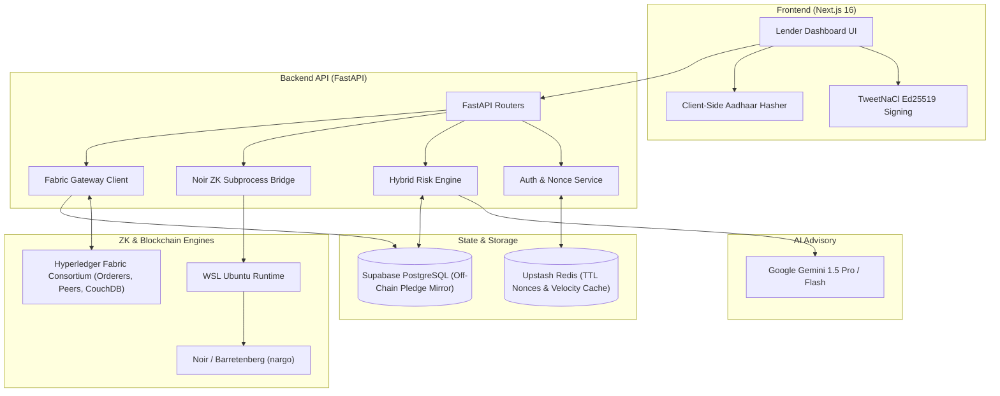
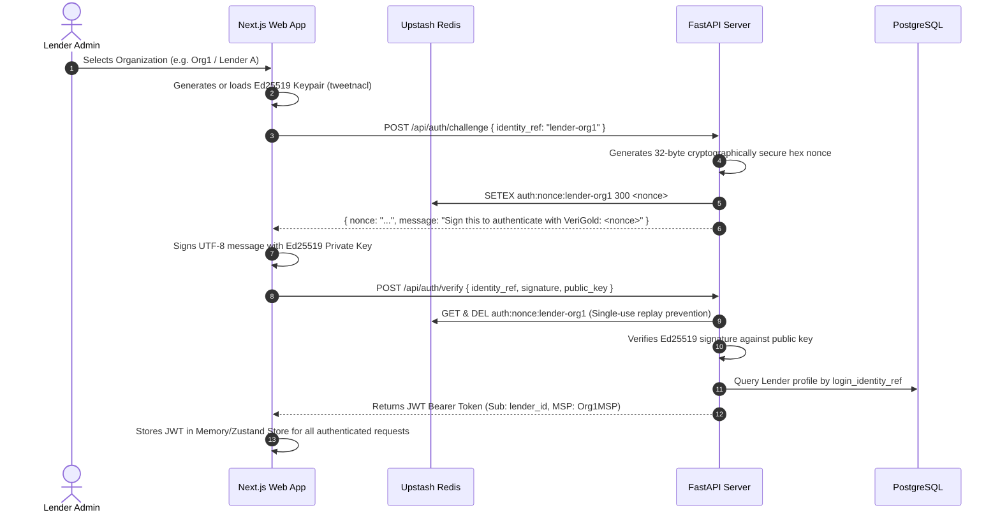
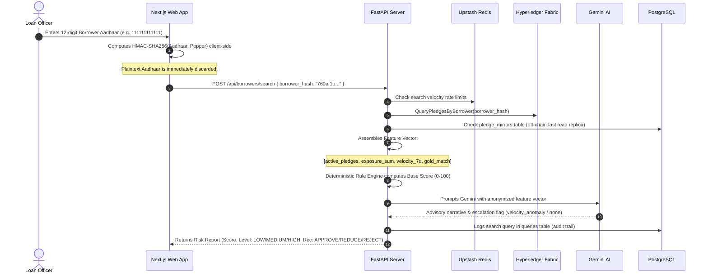
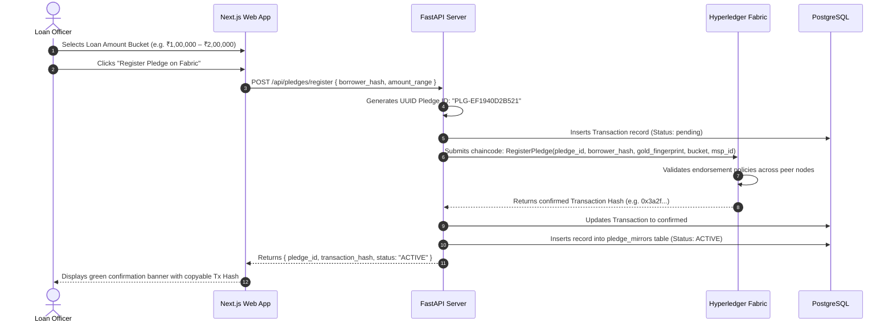
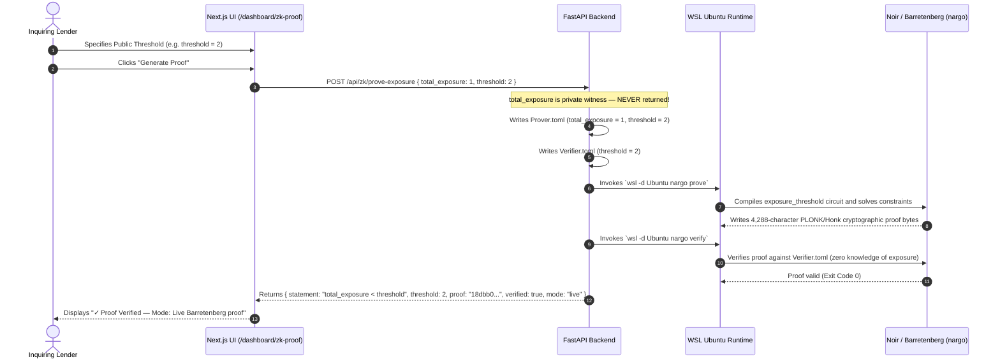
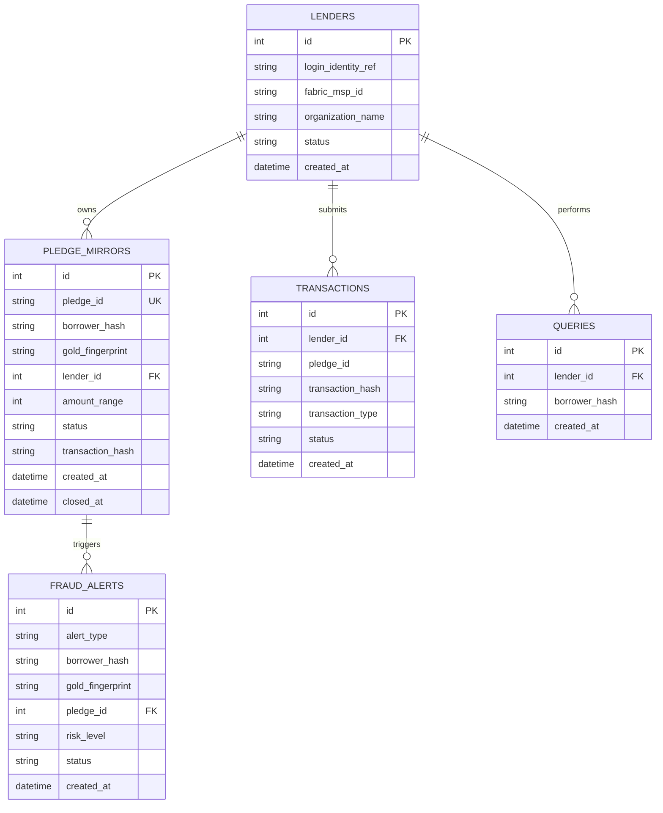

# VeriGold — Master End-to-End Workflow & Architecture Guide

> **Privacy-Preserving Cross-Lender Gold Loan Registry**  
> Powered by Hyperledger Fabric Blockchain, Zero-Knowledge Proofs (Noir), AI Risk Scoring (Gemini), and Dual-Factor Collateral Fingerprinting.

---

## 1. System Architecture Overview

VeriGold is an enterprise-grade consortium platform designed to prevent **gold loan double-pledging** across financial institutions (banks, NBFCs, and gold loan companies) without exposing customer identity, plaintext Aadhaar numbers, or proprietary loan balances.



---

## 2. Technology Stack Breakdown

| Layer | Technology | Key Responsibility |
| :--- | :--- | :--- |
| **Frontend** | Next.js 16 (React 19, Turbopack) | Responsive lender portal, cryptographic client-side hashing, signing. |
| **Client Crypto** | `tweetnacl` + `tweetnacl-util` | Ed25519 keypair generation and challenge signature without password transmission. |
| **Backend API** | FastAPI (Python 3.14 async) | High-concurrency REST endpoints, JWT verification, orchestration layer. |
| **Relational DB** | Supabase (PostgreSQL 16 via asyncpg) | Encrypted off-chain pledge mirror, audit query log, fraud alerts, transactions. |
| **Cache & State** | Upstash Redis | 5-minute challenge nonces (replay prevention), velocity rate-limiting. |
| **Zero-Knowledge** | Noir (`nargo`) + Barretenberg | Compiles circuits and computes PLONK/Honk proofs (`total_exposure < threshold`). |
| **Blockchain** | Hyperledger Fabric 2.5 | Private permissioned consortium ledger (`mychannel`), Go chaincode (`verigold`). |
| **AI Advisory** | Google Gemini Generative AI | Natural-language advisory risk narrative over borrower feature vectors. |

---

## 3. End-to-End Workflows

### Workflow 1: Passwordless Lender Authentication (Ed25519 Handshake)
VeriGold does not store passwords. Authentication relies on public-key cryptography where the lender proves possession of their private key.



---

### Workflow 2: Borrower Risk Assessment & Search
When a borrower applies for a gold loan, the bank verifies whether the borrower already has loans elsewhere without learning their private Aadhaar or leaking data.



---

### Workflow 3: Dual-Factor Gold Collateral Fingerprinting
Prevents borrowers from pledging the same physical gold jewelry at multiple institutions simultaneously.

1. **Factor 1: Physical Characteristic Canonical JSON Hash**
   - Appraiser enters:
     - Weight in grams (e.g. `22.50`)
     - Purity percentage (e.g. `91.60%` for 22K)
     - Item type (e.g. `Ring`, `Necklace`, `Bangle`)
     - Item count (e.g. `1`)
     - Dimensions (length, width in mm)
     - Hallmarks / Maker's marks (e.g. `BIS-916-HM`)
   - The backend sorts JSON keys canonically and hashes using **SHA-256**:
     $$\text{Fingerprint} = \text{SHA-256}(\text{CanonicalJSON}(\text{attributes}))$$

2. **Factor 2: Visual Difference Perceptual Hash (dHash)**
   - Appraiser uploads a photograph of the collateral.
   - The image is normalized (converted to grayscale, resized to $9 \times 8$).
   - Horizontal pixel gradient differences produce a **64-bit perceptual hash (pHash)**.
   - Resilient against lighting, rotation, and compression differences.

3. **Collateral Match Detection (`POST /api/gold/match-check`)**:
   - The engine searches active pledge mirrors for identical SHA-256 hashes or Hamming distance $< 10$ on pHash.
   - If found: Risk is escalated to **HIGH / REJECT**, and a cross-lender fraud alert is generated.

---

### Workflow 4: Pledge Registration & Blockchain Commitment
Once the borrower is approved, the loan is formally registered on the decentralized ledger.



---

### Workflow 5: Zero-Knowledge Exposure Proofs (Noir + Barretenberg)
Used when a consortium member or auditor needs to verify that a borrower's total aggregate debt across all other banks is below a risk ceiling without discovering what other loans exist.



---

### Workflow 6: Loan Repayment & Pledge Release
When the borrower repays their loan, the collateral pledge must be closed on the blockchain so the gold can be reclaimed or re-pledged elsewhere.

1. **Lender Portal (`/dashboard/pledges`)**:
   - The lender navigates to **"My Pledges"**.
   - Identifies the repaid pledge (e.g. `PLG-EF1940...`).
   - Clicks **"Close"**.
2. **Authorization & Ledger Verification (`POST /api/pledges/{pledge_id}/close`)**:
   - The backend checks `pledge_mirrors.lender_id == current_lender.id`.
   - **Crucial Invariant:** Other banks *cannot* close pledges belonging to a different lender.
3. **Chaincode Execution (`ClosePledge`)**:
   - Fabric executes `ClosePledge(pledge_id, lender_msp)`.
   - The on-chain state updates from `ACTIVE` &rarr; `CLOSED`.
   - The off-chain SQL mirror updates `status = closed` and records `closed_at` timestamp.
4. **Instant Registry Update**:
   - Subsequent borrower risk assessments or gold match checks immediately show 0 active exposure for that collateral.

---

## 4. Database Schema Overview



---

## 5. Security & Privacy Invariants (The 5 Golden Rules)

1. **Zero Plaintext Aadhaar:** Plaintext Aadhaar numbers never touch the network, the backend API, the database, or the blockchain. All indexing uses 64-character hex HMAC-SHA256 hashes salted with a secret consortium pepper.
2. **Zero Knowledge of Private Debt:** In cross-lender checks, a lender can verify whether a borrower's overall exposure is within safe limits via Noir ZK proofs without ever learning the borrower's total debt or which other banks hold their loans.
3. **Zero Password Database:** System authentication utilizes Ed25519 asymmetric cryptography with single-use Redis nonces (300-second TTL), rendering database password leaks impossible.
4. **Ownership Invariant on Ledger:** Only the owning lender MSP that submitted a pledge has cryptographic authorization to execute `ClosePledge` on the Fabric ledger.
5. **Decentralized Multi-Peer Consensus:** No single bank controls the registry. Endorsement policies require multi-party consensus across organizational nodes.

---

## 6. Project Directory Sitemap

```text
VeriGold/
├── backend/
│   ├── alembic/                 # Database migrations (asyncpg)
│   ├── app/
│   │   ├── config/              # Pydantic settings & locked RiskConfig
│   │   ├── db/                  # Async SQLAlchemy session factory
│   │   ├── middleware/          # JWT auth & CORS handling
│   │   ├── models/              # PostgreSQL models (Lender, PledgeMirror, etc.)
│   │   ├── routers/             # FastAPI endpoints (auth, borrowers, gold, pledges, zk)
│   │   ├── services/            # Business logic (zk_service, pledge_service, fabric_gateway)
│   │   └── utils/               # Audit logger & custom exceptions
│   └── risk_engine/             # Rule scoring engine + Gemini LLM advisory client
│
├── frontend/
│   ├── src/
│   │   ├── app/                 # Next.js App Router (dashboard, auth, gold-appraisal, zk-proof)
│   │   ├── components/          # Reusable UI components & layouts
│   │   ├── lib/                 # API axios client & TweetNaCl auth helpers
│   │   └── store/               # Zustand persistent auth state
│
├── fabric/                      # Hyperledger Fabric test-network orchestration scripts
│   └── network/                 # start.sh, deploy-chaincode.sh, enroll-lenders.sh
│
├── chaincode/                   # Go smart contracts deployed on Fabric
│   └── verigold/src/            # RegisterPledge, ClosePledge, Query functions
│
└── zk/                          # Noir Zero-Knowledge circuits
    └── circuits/
        └── exposure_threshold/  # Nargo.toml & src/main.nr (total_exposure < threshold)
```
